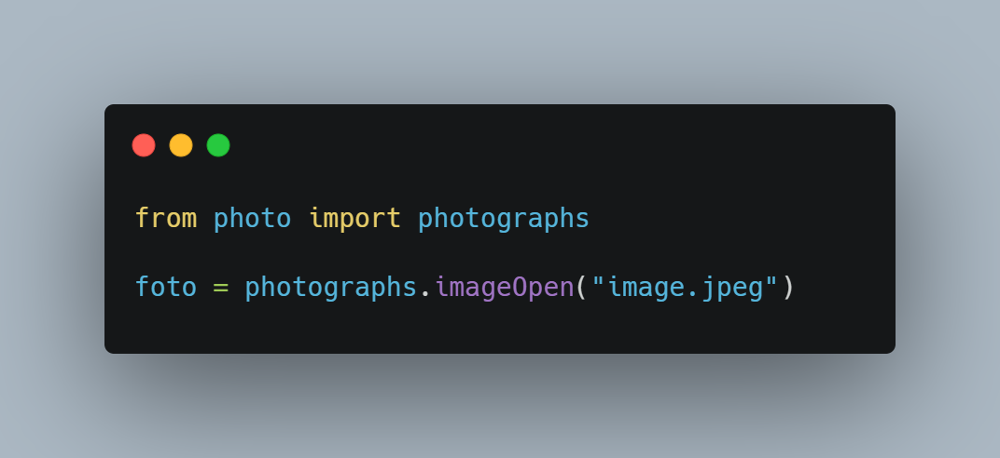
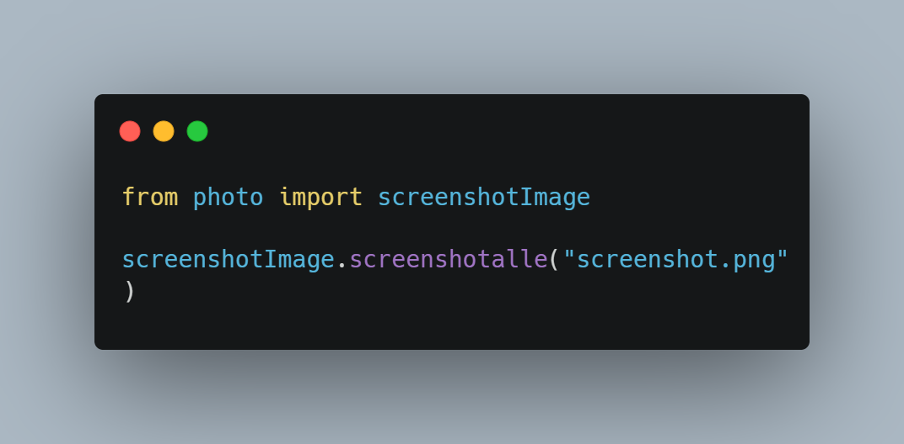
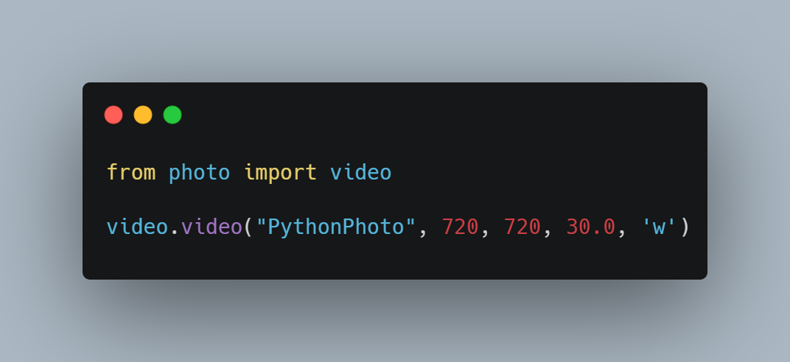
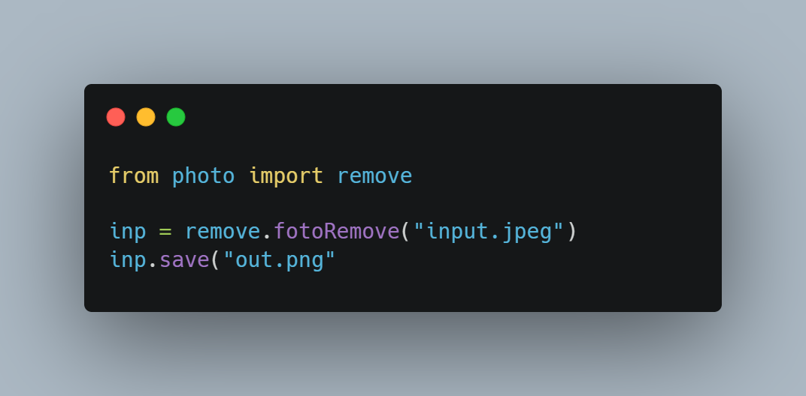

# PythonPhoto

**PythonPhoto** is a Python library for capturing screenshots, processing images, and basic video tasks.
It supports Python 3.8–3.12 and provides an easy way to work with images and video from your desktop.

---

## Features

- Open and edit images
- Crop, resize, blur, sharpen, and rotate images
- Add text and counters to images
- Convert image formats (JPG <-> PNG)
- Black & White and edge enhancement filters
- Capture full screen or selected region screenshots
- Video recording
- Remove image backgrounds

---

## Installation

```bash
git clone https://github.com/istoriya-islama/PythonPhoto.git
cd PythonPhoto
pip install -r requirements.txt
```

---

## Usage Examples

### 1. Image Operations

```python
from photo import photographs

# Open image
foto = photographs.imageOpen("image.jpeg")

# Crop image
photographs.imageCrop("image.jpeg", 0, 0, 100, 200, "imageCrop.jpg")

# Add text
photographs.imageFont("image.jpeg", "PythonPhoto", "arial.ttf", 15, "imagefont.jpg")

# Blur
photographs.imageBlur("image.jpeg", "imageBlur.jpg")

# Convert JPG to PNG
photographs.imageJpgInPng("image.jpeg", "imageJpgInPng.png")
```



---

### 2. Screenshots

```python
from photo import screenshotImage

# Full screen screenshot
screenshotImage.screenshotalle("screenshot.png")

# Screenshot selected size
screenshotImage.screenshotSize("PythonPhoto.png", 720, 720, 1280, 820)
```



---

### 3. Video

```python
from photo import video

# Record video
video.video("PythonPhoto", 720, 720, 30.0, 'w')
```



---

### 4. Remove Background

```python
from photo import remove

# Remove background
inp = remove.fotoRemove("input.jpeg")
inp.save("out.png")
```



---

## Requirements

- Python 3.8–3.12  
- Pillow  
- OpenCV (`opencv-python`)  
- PyAutoGUI  
- PyScreenshot  
- NumPy  

---

## License

This project is licensed under the **GNU General Public License v3.0 (GPL-3.0)**.  
You are free to **use, modify, and distribute** this library under the terms of the license.

For more details, see the [GNU GPL v3.0](https://www.gnu.org/licenses/gpl-3.0.html).
